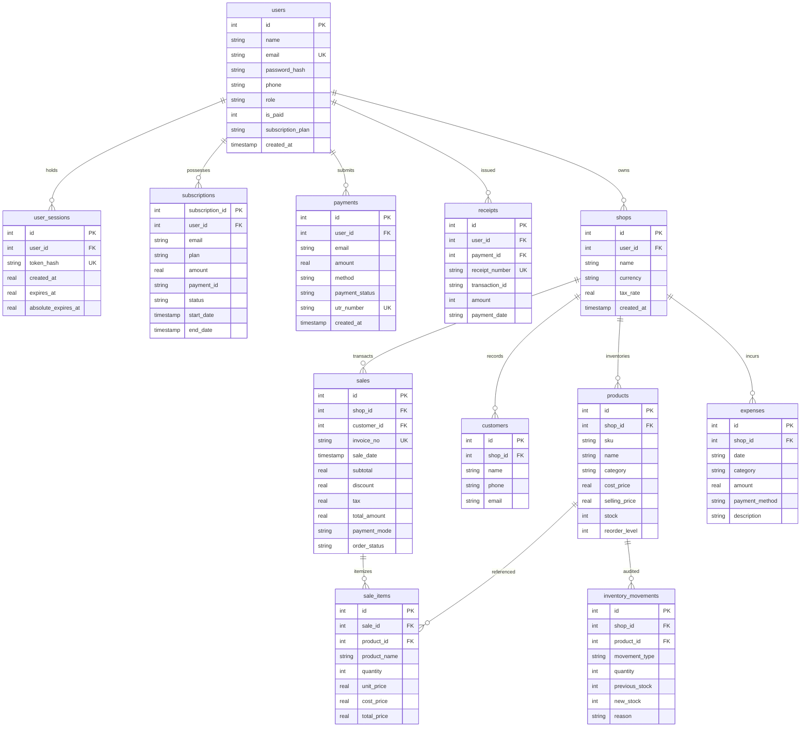

# CHAPTER 5: DATABASE DESIGN & DATA MODELING

---

## 5.1 Database Overview & Architecture

The persistence layer of the platform is designed according to **Third Normal Form (3NF)** principles to eliminate data redundancy and preserve referential integrity. Managed via [`database.py`](file:///f:/ganesh/smart/42435/database.py), the architecture supports dual relational database dialects:
1. **SQLite 3 (Embedded/Local Development)**: Operates against `gw_smart_analytics2.db` and `gw_payments.db`, enforcing `PRAGMA foreign_keys = ON;` and `PRAGMA busy_timeout = 30000;`.
2. **MySQL 8.0+ (Enterprise Cloud Production)**: Employs InnoDB storage engines with `utf8mb4_unicode_ci` character encoding, ACID-compliant transactions, and strict foreign key cascade enforcement.

---

## 5.2 Entity-Relationship (ER) Diagram

---

## 5.3 Detailed Data Dictionary (All 16 Tables)

### Table 1: `users`
Stores registered user accounts, administrative privileges, and global subscription states.
| Column | Type | Constraints | Description |
|---|---|---|---|
| `id` | INTEGER | PRIMARY KEY AUTOINCREMENT | Unique identifier for the user account |
| `name` | TEXT / VARCHAR(100) | NOT NULL | User's full display name |
| `email` | TEXT / VARCHAR(191) | NOT NULL, UNIQUE | User's unique login email address |
| `password_hash` | TEXT / VARCHAR(255) | NOT NULL | Cryptographic scrypt password hash |
| `phone` | TEXT / VARCHAR(20) | DEFAULT '' | Primary contact telephone number |
| `role` | TEXT / VARCHAR(20) | DEFAULT 'user' | Access control level (`user` or `admin`) |
| `is_paid` | INTEGER / TINYINT | DEFAULT 0 | Global active subscription flag (1 = active) |
| `subscription_plan` | TEXT / VARCHAR(50) | DEFAULT 'free' | Identifier for user's assigned tier |
| `subscription_start`| TIMESTAMP | NULL | Timestamp of subscription activation |
| `subscription_end` | TIMESTAMP | NULL | Expiration timestamp of current entitlement |
| `created_at` | TIMESTAMP | DEFAULT CURRENT_TIMESTAMP | Account registration timestamp |

### Table 2: `user_sessions`
Opaque session tokens for authentication without exposing user IDs in cookies.
| Column | Type | Constraints | Description |
|---|---|---|---|
| `id` | INTEGER | PRIMARY KEY AUTOINCREMENT | Unique session record ID |
| `user_id` | INTEGER | NOT NULL, FK -> users(id) ON DELETE CASCADE | Associated user ID |
| `token_hash` | TEXT / VARCHAR(64) | NOT NULL, UNIQUE | SHA-256 hash of opaque session cookie |
| `created_at` | REAL / DOUBLE | NOT NULL | Unix epoch timestamp of creation |
| `last_activity_at` | REAL / DOUBLE | NOT NULL | Unix epoch timestamp of most recent request |
| `expires_at` | REAL / DOUBLE | NOT NULL | Rolling idle expiration timestamp (12h TTL) |
| `absolute_expires_at`| REAL / DOUBLE | NOT NULL | Absolute hard expiration timestamp (30d TTL)|
| `revoked_at` | REAL / DOUBLE | NULL | Timestamp of manual logout or revocation |

### Table 3: `subscriptions`
Maintains verified 30-day Pro plan access windows.
| Column | Type | Constraints | Description |
|---|---|---|---|
| `subscription_id` | INTEGER | PRIMARY KEY AUTOINCREMENT | Unique subscription record identifier |
| `user_id` | INTEGER | NOT NULL, FK -> users(id) ON DELETE CASCADE | Owner user account |
| `email` | TEXT / VARCHAR(191) | NOT NULL | User's email at time of activation |
| `plan` | TEXT / VARCHAR(100) | DEFAULT 'Premium Monthly' | Entitlement plan name |
| `amount` | REAL / DECIMAL(10,2)| DEFAULT 10.0 | Cost paid for the entitlement period |
| `payment_id` | TEXT / VARCHAR(100) | NOT NULL | External reference or UTR number |
| `status` | TEXT / VARCHAR(20) | DEFAULT 'ACTIVE' | Subscription status (`ACTIVE`, `EXPIRED`) |
| `start_date` | TIMESTAMP | DEFAULT CURRENT_TIMESTAMP | Effective starting date |
| `end_date` | TIMESTAMP | NOT NULL | Expiry date (strictly verified on request) |

### Table 4: `payments`
Tracks UPI claims, gateway checkout orders, and administrative approval states.
| Column | Type | Constraints | Description |
|---|---|---|---|
| `id` | INTEGER | PRIMARY KEY AUTOINCREMENT | Unique payment transaction ID |
| `user_id` | INTEGER | FK -> users(id) ON DELETE CASCADE | Associated paying user |
| `email` | TEXT / VARCHAR(191) | NOT NULL | Billing email address |
| `amount` | REAL / DECIMAL(10,2)| NOT NULL | Transaction amount in INR (fixed server-side)|
| `method` | TEXT / VARCHAR(50) | NOT NULL | Payment instrument (`UPI`, `Razorpay`) |
| `order_id` | TEXT / VARCHAR(100) | NULL | External gateway order reference |
| `payment_status` | TEXT / VARCHAR(30) | DEFAULT 'PENDING' | Review state (`PENDING`, `CAPTURED`, `REJECTED`)|
| `utr_number` | TEXT / VARCHAR(100) | UNIQUE, NULL | 12-digit bank UPI transaction reference |
| `status` | TEXT / VARCHAR(20) | DEFAULT 'approved' | Approval state flag |
| `valid_until` | TIMESTAMP | NULL | Entitlement expiration calculated upon approval |

### Table 5: `receipts`
Official, tamper-proof payment receipts for auditing and PDF generation.
| Column | Type | Constraints | Description |
|---|---|---|---|
| `id` | INTEGER | PRIMARY KEY AUTOINCREMENT | Unique receipt sequence ID |
| `user_id` | INTEGER | NOT NULL, FK -> users(id) | Associated account |
| `payment_id` | INTEGER | FK -> payments(id) | Originating payment record |
| `receipt_number` | TEXT / VARCHAR(50) | NOT NULL, UNIQUE | Formatted identifier (e.g. `RCPT-YYYYMMDD-HHMMSS`)|
| `transaction_id` | TEXT / VARCHAR(100) | NOT NULL | Verified UTR or Gateway Transaction ID |
| `amount` | INTEGER / REAL | NOT NULL | Amount paid in INR |
| `payment_date` | TEXT / VARCHAR(50) | NOT NULL | Formatted payment date |
| `created_at` | TEXT / VARCHAR(50) | NOT NULL | Receipt creation timestamp |

### Table 6: `shops`
Multi-tenant store configurations isolating merchant settings.
| Column | Type | Constraints | Description |
|---|---|---|---|
| `id` | INTEGER | PRIMARY KEY AUTOINCREMENT | Unique shop identifier |
| `user_id` | INTEGER | NOT NULL, FK -> users(id) ON DELETE CASCADE | Account holding ownership of this shop |
| `name` | TEXT / VARCHAR(150) | DEFAULT 'My Smart Shop' | Display business name |
| `owner_name` | TEXT / VARCHAR(100) | DEFAULT '' | Merchant proprietor name |
| `currency` | TEXT / VARCHAR(10) | DEFAULT '₹' | Active monetary symbol (`₹`, `$`, `€`, `£`) |
| `tax_rate` | REAL / DECIMAL(5,2) | DEFAULT 0.0 | Default tax percentage applied to sales |
| `business_type` | TEXT / VARCHAR(50) | DEFAULT 'Retail' | Category classification (`Retail`, `Wholesale`)|

### Table 7: `products`
The retail catalog with SKU collision guards and inventory balances.
| Column | Type | Constraints | Description |
|---|---|---|---|
| `id` | INTEGER | PRIMARY KEY AUTOINCREMENT | Unique product inventory ID |
| `shop_id` | INTEGER | NOT NULL, FK -> shops(id) ON DELETE CASCADE | Parent shop store |
| `sku` | TEXT / VARCHAR(100) | NOT NULL | Unique Stock Keeping Unit / Barcode |
| `name` | TEXT / VARCHAR(200) | NOT NULL | Product title and description |
| `category` | TEXT / VARCHAR(100) | DEFAULT 'General' | Department or classification |
| `cost_price` | REAL / DECIMAL(10,2)| DEFAULT 0.0 | Purchase acquisition cost (for COGS) |
| `selling_price`| REAL / DECIMAL(10,2)| DEFAULT 0.0 | Retail customer checkout price |
| `stock` | INTEGER | DEFAULT 0 | Current in-stock quantity on shelf |
| `reorder_level`| INTEGER | DEFAULT 5 | Low-stock red alert threshold |

### Table 8: `customers`
Customer relationship records for lifetime value (LTV) and CRM tracking.
| Column | Type | Constraints | Description |
|---|---|---|---|
| `id` | INTEGER | PRIMARY KEY AUTOINCREMENT | Customer CRM sequence ID |
| `shop_id` | INTEGER | NOT NULL, FK -> shops(id) ON DELETE CASCADE | Associated merchant shop |
| `name` | TEXT / VARCHAR(150) | NOT NULL | Customer's full name |
| `phone` | TEXT / VARCHAR(20) | DEFAULT '' | Customer telephone number |
| `email` | TEXT / VARCHAR(191) | DEFAULT '' | Customer email address |

### Table 9: `sales`
Invoices recording customer POS transactions.
| Column | Type | Constraints | Description |
|---|---|---|---|
| `id` | INTEGER | PRIMARY KEY AUTOINCREMENT | Sales invoice transaction ID |
| `shop_id` | INTEGER | NOT NULL, FK -> shops(id) ON DELETE CASCADE | Originating merchant shop |
| `customer_id` | INTEGER | NULL, FK -> customers(id) ON DELETE SET NULL | Associated customer (if registered) |
| `invoice_no` | TEXT / VARCHAR(50) | NOT NULL, UNIQUE | Formatted invoice code (`INV-...`) |
| `sale_date` | TIMESTAMP | DEFAULT CURRENT_TIMESTAMP | Transaction timestamp |
| `subtotal` | REAL / DECIMAL(10,2)| DEFAULT 0.0 | Sum of gross line item prices |
| `discount` | REAL / DECIMAL(10,2)| DEFAULT 0.0 | Total invoice discount applied |
| `tax` | REAL / DECIMAL(10,2)| DEFAULT 0.0 | Tax amount computed based on shop rate |
| `total_amount` | REAL / DECIMAL(10,2)| DEFAULT 0.0 | Final settlement total payable |
| `payment_mode` | TEXT / VARCHAR(30) | DEFAULT 'Cash' | Instrument (`Cash`, `UPI`, `Card`, `Bank`) |
| `order_status` | TEXT / VARCHAR(20) | DEFAULT 'Completed' | Status (`Completed`, `Cancelled`) |

### Table 10: `sale_items`
Individual line items itemizing product sales, quantities, and cost values.
| Column | Type | Constraints | Description |
|---|---|---|---|
| `id` | INTEGER | PRIMARY KEY AUTOINCREMENT | Line item record ID |
| `sale_id` | INTEGER | NOT NULL, FK -> sales(id) ON DELETE CASCADE | Associated invoice |
| `product_id` | INTEGER | NULL, FK -> products(id) ON DELETE SET NULL | Reference to catalog product |
| `product_name` | TEXT / VARCHAR(200) | NOT NULL | Snapshot of product name at sale time |
| `quantity` | INTEGER | DEFAULT 1 | Quantity purchased |
| `unit_price` | REAL / DECIMAL(10,2)| DEFAULT 0.0 | Selling price per unit at checkout |
| `cost_price` | REAL / DECIMAL(10,2)| DEFAULT 0.0 | Acquisition cost at checkout (preserves historical COGS) |
| `total_price` | REAL / DECIMAL(10,2)| DEFAULT 0.0 | Line item subtotal ($Qty \times Unit Price$) |

### Table 11: `expenses`
Operating expenses for overhead tracking and Net Profit deductions.
| Column | Type | Constraints | Description |
|---|---|---|---|
| `id` | INTEGER | PRIMARY KEY AUTOINCREMENT | Expense entry ID |
| `shop_id` | INTEGER | NOT NULL, FK -> shops(id) ON DELETE CASCADE | Associated merchant shop |
| `date` | TEXT / VARCHAR(20) | NOT NULL | Date of expenditure (`YYYY-MM-DD`) |
| `category` | TEXT / VARCHAR(100) | NOT NULL | Category (`Rent`, `Salary`, `Electricity`, etc.)|
| `amount` | REAL / DECIMAL(10,2)| DEFAULT 0.0 | Expenditure amount |
| `payment_method`| TEXT / VARCHAR(30)| DEFAULT 'Cash' | Disbursal method |
| `description` | TEXT | DEFAULT '' | Explanatory note or memo |

### Table 12: `inventory_movements`
Immutable audit log tracking all physical stock modifications.
| Column | Type | Constraints | Description |
|---|---|---|---|
| `id` | INTEGER | PRIMARY KEY AUTOINCREMENT | Movement audit sequence ID |
| `shop_id` | INTEGER | NOT NULL, FK -> shops(id) ON DELETE CASCADE | Associated shop |
| `product_id` | INTEGER | NOT NULL, FK -> products(id) ON DELETE CASCADE | Subject catalog product |
| `movement_type`| TEXT / VARCHAR(30) | NOT NULL | Type (`Sale`, `Restock`, `Damage`, `Return`)|
| `quantity` | INTEGER | NOT NULL | Absolute units changed |
| `previous_stock`| INTEGER | DEFAULT 0 | Stock balance prior to modification |
| `new_stock` | INTEGER | DEFAULT 0 | Stock balance following modification |
| `reason` | TEXT | DEFAULT '' | Auditor memo or reference invoice code |

### Table 13: `audit_logs`
System security and administrative audit trails.
| Column | Type | Constraints | Description |
|---|---|---|---|
| `id` | INTEGER | PRIMARY KEY AUTOINCREMENT | System log sequence ID |
| `shop_id` | INTEGER | NOT NULL, FK -> shops(id) ON DELETE CASCADE | Associated store tenant |
| `action` | TEXT / VARCHAR(100) | NOT NULL | Action verb (`CREATE_PRODUCT`, `CANCEL_SALE`)|
| `entity` | TEXT / VARCHAR(50) | NOT NULL | Target entity table |
| `entity_id` | INTEGER | NULL | Primary key of target entity |
| `user_id` | INTEGER | NULL | Actor who executed the transaction |
| `old_values` | TEXT / JSON | NULL | JSON snapshot of previous attributes |
| `new_values` | TEXT / JSON | NULL | JSON snapshot of updated attributes |

### Table 14: `uploads`
Tracks uploaded tabular datasets stored in the private filesystem.
| Column | Type | Constraints | Description |
|---|---|---|---|
| `id` | INTEGER | PRIMARY KEY AUTOINCREMENT | Upload record ID |
| `user_id` | INTEGER | NULL, FK -> users(id) ON DELETE SET NULL | Owner user account |
| `original_name`| TEXT / VARCHAR(255) | NOT NULL | Original client file name (`sales.csv`) |
| `saved_name` | TEXT / VARCHAR(255) | NOT NULL | Cryptographic UUID storage filename |
| `file_size` | INTEGER | DEFAULT 0 | File size in bytes |
| `created_at` | TIMESTAMP | DEFAULT CURRENT_TIMESTAMP | Ingestion timestamp |

### Table 15: `gateway_orders`
Server-side orders created for gateway checkouts (Razorpay/Cashfree).
| Column | Type | Constraints | Description |
|---|---|---|---|
| `order_id` | TEXT / VARCHAR(100) | PRIMARY KEY | Gateway-issued order identifier |
| `user_id` | INTEGER | NOT NULL, FK -> users(id) ON DELETE CASCADE | Purchasing user account |
| `amount_paise` | INTEGER | NOT NULL | Order amount in lowest denomination (Paise)|
| `status` | TEXT / VARCHAR(30) | DEFAULT 'CREATED' | Order status (`CREATED`, `PAID`, `EXPIRED`)|
| `payment_id` | TEXT / VARCHAR(100) | UNIQUE, NULL | Gateway-confirmed payment capture ID |

### Table 16: `auth_tokens`
Bridge tokens facilitating cross-application session synchronization.
| Column | Type | Constraints | Description |
|---|---|---|---|
| `token` | TEXT / VARCHAR(64) | PRIMARY KEY | Cryptographically secure bridge token |
| `user_id` | INTEGER | NOT NULL, FK -> users(id) ON DELETE CASCADE | Subject user account |
| `expires_at` | REAL / DOUBLE | NOT NULL | Unix epoch expiration timestamp |
| `web_session_id`| INTEGER | NULL | Reference to originating `user_sessions` ID |

---

## 5.4 Referential Integrity & Cascade Rules
- **User Cascade Deletion**: Deleting an account in `users` automatically cascades to purge that user's `user_sessions`, `subscriptions`, `payments`, `shops`, and `gateway_orders`, preventing orphaned records.
- **Shop Cascade Isolation**: Deleting a `shop` automatically deletes its child `products`, `customers`, `sales`, `expenses`, `inventory_movements`, and `audit_logs`.
- **Sale Items Referential Protection**: Products linked to historical `sale_items` cannot be erased without trace; if a catalog item is purged, foreign key constraints set `sale_items.product_id` to `NULL` while retaining `product_name`, `unit_price`, and `cost_price` to preserve historical financial statements.
