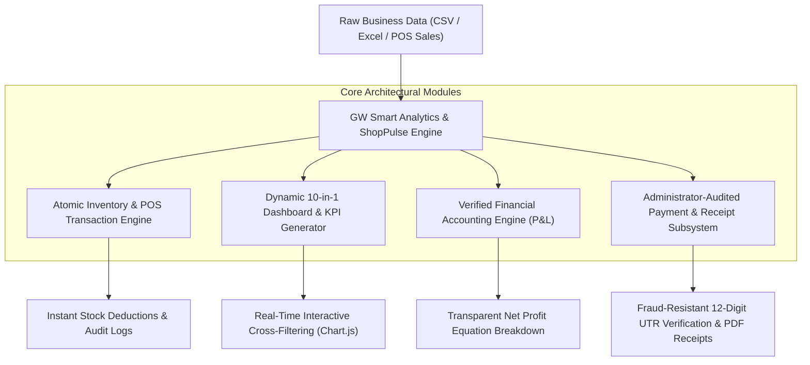

# CHAPTER 2: PROBLEM STATEMENT AND EXISTING SYSTEM

---

## 2.1 Existing System Overview
In the conventional retail and enterprise analytics landscape, small-to-medium businesses (SMBs) manage operations through three disjointed approaches:

1. **Manual Physical Ledgers & Paper Receipts**: 
   Transactions are handwritten into paper registers. Stock counts are performed periodically via physical counts, with no continuous visibility into stock shrinkage or cost variances.
2. **Generic Desktop Spreadsheets (Microsoft Excel / Google Sheets)**:
   Store owners attempt to maintain separate sheets for daily sales, inventory levels, supplier contacts, and expenses. These files lack referential integrity constraints, concurrent multi-user editing safety, and automated business logic.
3. **Monolithic Commercial ERP Systems (SAP, Tally, Zoho, NetSuite)**:
   While feature-rich, these platforms require significant hardware infrastructure, complex SQL installations, expensive annual recurring maintenance, and specialized operator training.

---

## 2.2 Identified Deficiencies & Failure Points
Through rigorous field observation and codebase analysis, several critical failure points were identified in traditional workflows:

- **Lack of Atomic Data Consistency**: In spreadsheet setups, entering a sale does not automatically deduct inventory from stock sheets. Cashiers must manually decrement stock rows, routinely resulting in severe discrepancies and unrecorded sales.
- **Vulnerability to Accidental Data Corruption**: Spreadsheets allow arbitrary row deletion, formula tampering, and lack audit trails. A single corrupted formula can invalidate an entire quarter of tax calculations.
- **Inability to Derive Cross-Chart Insights**: Visualizing trends across multiple variables (e.g., filtering top revenue products specifically within the 'Electronics' category across a 14-day window) requires complex manual pivot tables and lookup formulas.
- **Payment Reconciliation Fraud**: Manual payment handling exposes merchants to fraudulent claims, such as customers presenting forged UPI payment confirmation screenshots.
- **Reporting Inefficiencies**: Compiling an executive performance report with Key Performance Indicators (KPIs) and visual graphs currently requires multiple hours of manual copying, formatting, and PDF conversion.

---

## 2.3 Proposed Solution: GW Smart Analytics & ShopPulse
The proposed platform addresses every identified limitation through an integrated, web-native software architecture:

- **Universal Tabular Parsing**: Uploading any standard CSV or Excel file triggers instant automated schema normalization, KPI computation, and multi-chart dashboard population without requiring manual column mappings.
- **Integrated Shop Management POS**: A dedicated retail suite with 14 modular tabs unifying product catalogs, POS cashier checkouts, inventory restock logs, expense categorizations, and customer lifetime value metrics.
- **Deterministic Math Engine**: All financial calculations (AOV, Gross Profit, Operating Overheads, Net Margin) are calculated deterministically on the server and database layer, preventing mathematical inaccuracies.
- **Secure Financial Gateway**: Payment claims require unique 12-digit bank UTR entry and administrator cross-verification, preventing duplicate or fraudulent claims.

---

## 2.4 Comparative Feature Analysis

| Evaluation Metric | Traditional Manual Ledgers | Spreadsheets (Excel / Sheets) | Monolithic Enterprise ERP | **GW Smart Analytics & ShopPulse** |
|---|---|---|---|---|
| **Setup Cost** | Low | Low to Moderate | Extremely High ($2,000+) | **Near Zero (Web Browser Native)** |
| **Learning Curve** | Low | Moderate | Very Steep (Specialized training) | **Minimal (Intuitive Glassmorphic UI)** |
| **Inventory Atomicity** | Non-existent | Manual / Script-dependent | High | **100% Atomic SQL Transactions** |
| **Automated Dashboards** | No | Requires manual pivot tables | Configurable but complex | **Instant (10 Vertical Templates)** |
| **Multi-Chart Cross-Filtering**| No | Limited (Slicers) | Yes | **Native Interactive Chart.js Clicks** |
| **Audit Trails & Logs** | None | Limited version history | High | **Immutable `inventory_movements` & `audit_logs`** |
| **POS Barcode Integration** | None | Complex plugin setup | Supported | **Native POS & Line-Item Management** |
| **Payment Fraud Prevention** | None | None | Gateway add-ons | **12-Digit UTR + Admin Gatekeeping** |
| **Export Formats** | Paper only | Excel / CSV | Proprietary exports | **PDF, Excel, CSV, High-Res Print** |

---

## 2.5 Strategic & Operational Advantages
1. **Zero Client Installation**: Operators access the system instantly through standard modern web browsers (Chrome, Edge, Firefox, Safari) without installing database runtimes on local workstations.
2. **Instant Business Insights**: The 10 specialized templates allow managers to transition from raw rows of data to strategic visual charts in less than one second.
3. **Strict Data Ownership**: User datasets and private shop records are partitioned via strict relational user constraints (`FOREIGN KEY (user_id) REFERENCES users(id)`), ensuring total data isolation in multi-tenant environments.
