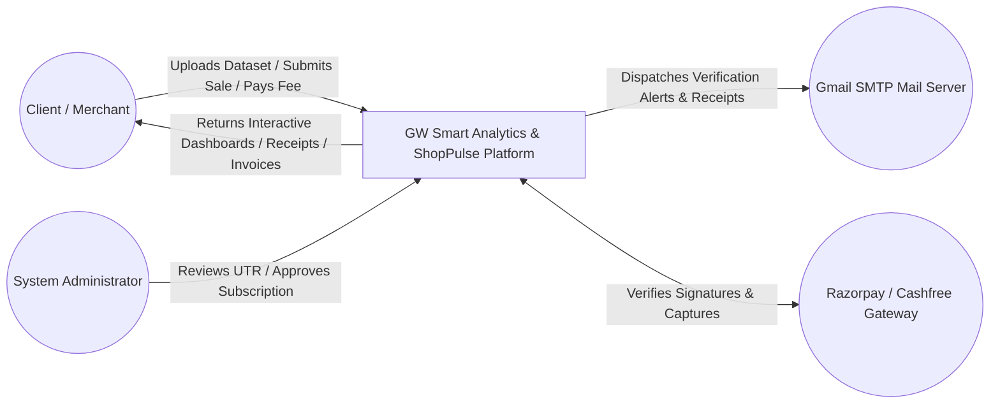
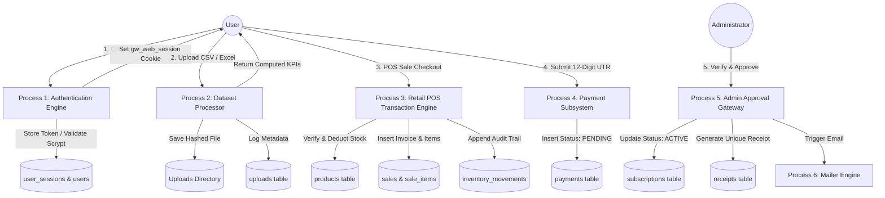
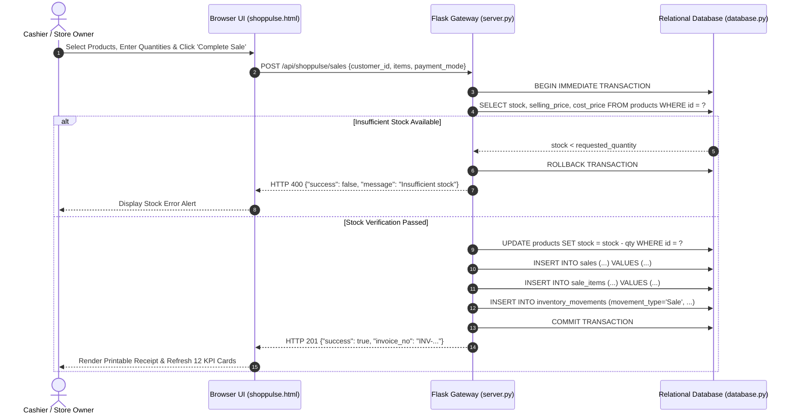

# CHAPTER 4: SYSTEM ARCHITECTURE

---

## 4.1 Overall Architectural Topology

The GW Smart Analytics & ShopPulse platform is architected as an enterprise-grade, four-tier web application designed for high throughput, atomic transactional integrity, and horizontal scalability:

```mermaid
graph TD
    subgraph Tier1["Tier 1: Presentation & Client Layer (Browser)"]
        UI1["GW Dashboard Generator (h.html)"]
        UI2["Universal Analytics (up.html)"]
        UI3["ShopPulse Retail Suite (shoppulse.html)"]
        UI4["Admin Portal (admin-payments.html)"]
        ClientParsers["PapaParse / SheetJS / Chart.js / html2canvas"]
    end

    subgraph Tier2["Tier 2: API Gateway & Security Firewall (Flask)"]
        Router["Flask URL Routing Engine (server.py)"]
        AuthFilter["before_request Session Authenticator"]
        SecurityHeaders["after_request Security Header Injector"]
        RateLimiter["Token Bucket Rate Limiter"]
    end

    subgraph Tier3["Tier 3: Business Logic & Processing Subsystems (Python)"]
        ShopService["ShopPulse POS & Inventory Engine"]
        AnalyticsService["KPI Aggregation & Formula Calculator"]
        UploadStorage["Sandboxed File Storage (upload_storage.py)"]
        MailerEngine["SMTP Notification Dispatcher (mailer.py)"]
        PaymentVerifier["Payment Gateway Verifier (gwpeyment.py)"]
    end

    subgraph Tier4["Tier 4: Relational Persistence Layer (SQL)"]
        SQLCore[("Relational Database Engine\n(SQLite WAL Mode / MySQL 8.0)")]
        TableAccounts["users / user_sessions / auth_tokens"]
        TableFinance["subscriptions / payments / receipts / gateway_orders"]
        TableRetail["shops / products / sales / sale_items / expenses"]
        TableAudit["inventory_movements / audit_logs / uploads"]
    end

    Tier1 <-->|HTTPS REST / JSON / Cookies| Tier2
    Tier2 --> Tier3
    Tier3 <-->|Atomic Parameterized SQL| Tier4
```



---

## 4.2 Presentation Layer Architecture
The user interface layer is built with high-performance vanilla JavaScript and standard HTML5/CSS3, deliberately avoiding the bundle bloat, runtime overhead, and hydration delays of heavy JavaScript frameworks.
- **Client-Side Data Ingestion Engine**: Utilizes PapaParse for multithreaded streaming CSV parsing and SheetJS (`xlsx.full.min.js`) for binary Excel parsing directly in memory.
- **Dynamic Visualization Engine**: Harnesses Chart.js to render hardware-accelerated HTML5 `<canvas>` elements for lines, clustered bars, and doughnut breakdowns.
- **Glassmorphic Design System**: Uses responsive CSS grid layouts, CSS custom properties (`--tz-bg`, `--tz-card`, `--tz-accent`), and backdrop blur filters.

---

## 4.3 Backend & API Gateway Architecture
The backend application gateway is driven by Python Flask 3.1.1 and Werkzeug:
- **Central Gateway Controller (`server.py`)**: Defines route listeners for presentation assets, user authentication, dataset uploads, retail shop management, and payment verification.
- **Global Pre-Request Security Interceptor (`authenticate_api_request`)**:
  ```python
  @app.before_request
  def authenticate_api_request():
      if request.path.startswith("/api/") and request.path not in PUBLIC_API_PATHS:
          user = database.validate_web_session(request.cookies.get("gw_web_session", ""))
          if not user:
              return jsonify({"success": False, "authenticated": False, "message": "Login required."}), 401
          g.current_user = user
  ```
- **Hardened HTTP Response Headers (`add_security_headers`)**:
  - `X-Content-Type-Options: nosniff` (Mitigates MIME confusion attacks).
  - `X-Frame-Options: SAMEORIGIN` (Mitigates clickjacking attacks).
  - `Referrer-Policy: same-origin` (Protects sensitive request context).
  - `Cache-Control: no-store` (Prevents client-side caching of private business data).

---

## 4.4 Data Flow Diagrams (DFD)

### 4.4.1 Level-0 Context DFD


### 4.4.2 Level-1 Detailed Process DFD


---

## 4.5 Component Interaction & Transaction Sequence

The sequence below illustrates the atomic execution flow during a Point-of-Sale customer transaction:



---

## 4.6 Deployment Architecture & Production Readiness
The application is structured for production deployment across Linux container environments (Docker, Kubernetes) or direct Virtual Private Server (VPS) hosts:
- **Application Server**: Gunicorn / uWSGI multi-worker WSGI server behind an Nginx reverse proxy handling SSL/TLS termination.
- **Process Supervision**: Systemd service manager ensuring automatic daemon restarts on crash or host reboots.
- **Relational Storage**: MySQL 8.0 server with InnoDB buffer pool optimization or high-performance SQLite WAL mode with scheduled automated backups (`.bak`).
