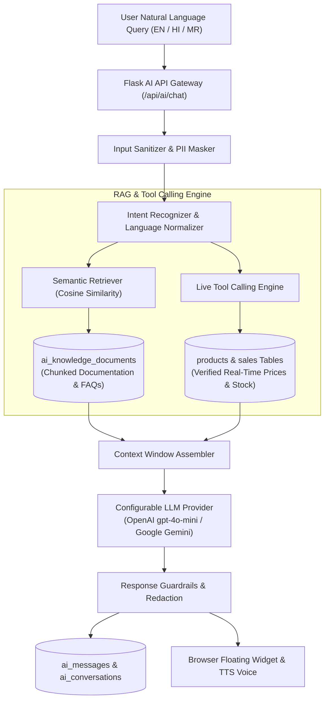

# CHAPTER 9: ARTIFICIAL INTELLIGENCE IMPLEMENTATION

---

## 9.1 Implemented AI Capabilities vs. Architectural Roadmap

To uphold rigorous technical documentation standards, this chapter distinguishes between:
1. **Implemented & Verified AI Features**: Ground truth code currently functioning in the repository.
2. **Planned & Architectural Enhancements**: The enterprise LLM & RAG integration specified in the architecture blueprint.

---

## 9.2 Implemented AI Functionality (Verified in Source Code)

### 9.2.1 Verified SQL-Math Business Intelligence Assistant
Implemented in [`database.py:query_ai_assistant`](file:///f:/ganesh/smart/42435/database.py#L2994-L3050) and [`server.py:shoppulse_ai_assistant_api`](file:///f:/ganesh/smart/42435/server.py#L1001-L1013):
- **Endpoint**: `POST /api/shoppulse/ai-assistant`
- **Mechanism**: Natural language question analyzer coupled with deterministic database calculations.
- **Mathematical Grounding**: When a user asks questions such as *"How much sales this month?"* or *"What is my top revenue product?"*, the engine executes actual SQL queries against `sales`, `sale_items`, and `products`.
- **Zero Hallucination Guarantee**: Returns actual numerical figures directly from the database rather than predicting numbers:
  ```python
  data = get_shop_dashboard_analytics(shop_id, date_filter="this_month")
  kpis = data["kpis"]
  # Returns exact verified numbers:
  # "Total sales this month are ₹14,250.00 across 42 orders with an AOV of ₹339.28."
  ```
- **Actionable Strategic Recommendations**: Automatically appends actionable retail business advice based on KPI ratios (e.g., recommending product bundles to lift AOV if margins are healthy).

### 9.2.2 Multilingual Natural Language Parsing Prototype
Implemented across [`up.html:3751-3769`](file:///f:/ganesh/smart/42435/up.html#L3751-L3769) and [`assistent.py`](file:///f:/ganesh/smart/42435/assistent.py):
- **Trilingual Keyword & Intent Classifier**: Detects user intent across **English**, **Hindi (हिंदी)**, and **Marathi (मराठी)** including transliterated Marathi (Hinglish/Marathiglish).
- **Supported Intent Categories**:
  - Greeting / Namaskar: `"hi"`, `"hello"`, `"namaste"`, `"namaskar"`, `"नमस्कार"`, `"हॅलो"`
  - Payments & UTR: `"pay"`, `"upi"`, `"utr"`, `"paise"`, `"पैसे"`, `"qr"`, `"receipt"`, `"पावती"`, `"pavti"`
  - Technical Troubleshooting: `"error"`, `"chalat nahi"`, `"kaam karat nahi"`, `"samasya"`, `"समस्या"`
  - Dataset Operations: `"upload"`, `"csv"`, `"excel"`, `"report"`, `"अहवाल"`
- **Rate Limiting Engine**: `assistent.py` incorporates an in-memory sliding window limiter restricting requests to 20 queries per 60 seconds per IP address to prevent denial-of-service abuse.

---

## 9.3 Planned & Approved LLM RAG Architecture

As outlined in the [Architecture Blueprint](file:///C:/Users/whari/.gemini/antigravity/brain/cf94f69f-213d-402a-adcd-6a943bba7c6b/ai_assistant_architecture_blueprint.md), the production AI engine transitions from rule-based parsing to an enterprise LLM architecture:



### 9.3.1 Key Architectural Components
1. **Configurable Model Adapter (`ai_provider.py`)**: Supports OpenAI (`gpt-4o-mini`), Google Gemini, or self-hosted OpenAI-compatible LLM endpoints via `.env` configuration.
2. **Context & Memory Manager**: Retains rolling multi-turn history stored in `ai_messages`, partitioning threads securely by user account (`user_id`).
3. **Retrieval-Augmented Generation (RAG)**: Indexes website user guides, dashboard capabilities, payment instructions, and FAQs into vector embeddings for grounded retrieval.
4. **Multimodal Voice Interaction**: Employs the browser-native Web Speech API (`SpeechRecognition` for microphone input and `SpeechSynthesis` for audio playback) supporting English (`en-IN`), Hindi (`hi-IN`), and Marathi (`mr-IN`) with zero external audio latency or licensing fees.
5. **Strict Financial Guardrails**: The LLM is strictly isolated from executing financial transactions, modifying order records, or collecting payment credentials (CVVs, PINs, card numbers).
