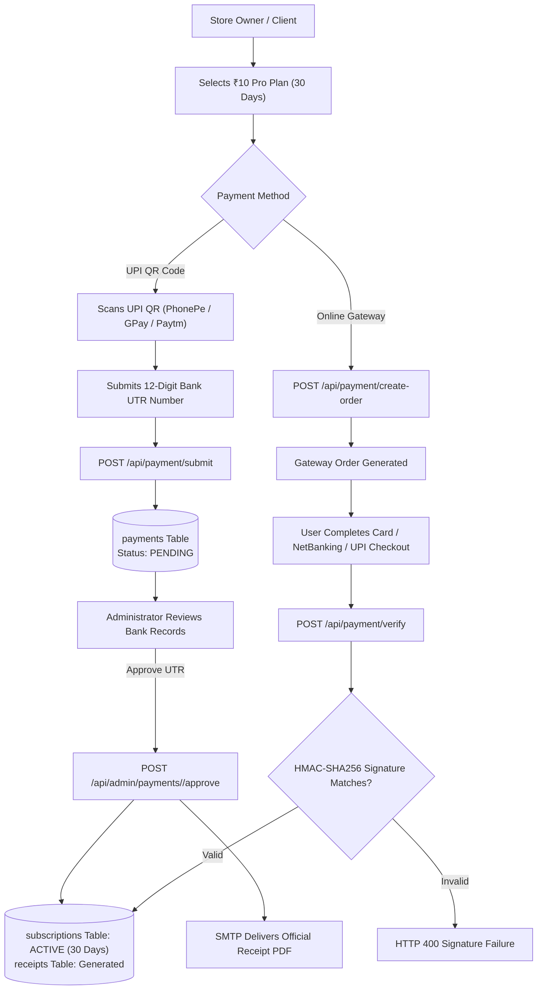

# CHAPTER 10: PAYMENT AND TRANSACTION SYSTEM

---

## 10.1 Payment Subsystem Architecture

The platform provides a secure monetization and subscription model designed around a **dual payment processing architecture**:
1. **Direct UPI with Administrative Verification**: A low-friction, zero-fee payment pathway for grassroots merchants scanning dynamic QR codes and submitting 12-digit bank UTR numbers.
2. **Automated Gateway Integration**: Server-to-server order generation and cryptographic verification supporting Razorpay and Cashfree SDK environments.



---

## 10.2 Admin-Verified UPI Workflow (Ground Truth Implementation)
Implemented in [`server.py`](file:///f:/ganesh/smart/42435/server.py#L477-L518) and [`database.py`](file:///f:/ganesh/smart/42435/database.py#L499-L530):
- **Server-Enforced Pricing**: The price is strictly locked on the server to `PLAN_PRICE` (₹10.00) from `.env`; client-supplied pricing overrides are completely rejected.
- **Strict 12-Digit UTR Validation**: The system evaluates submitted UTRs via regex (`^\d{12}$`). Duplicate submissions of the same UTR are blocked at the database level via a unique index on `payments.utr_number`.
- **Pending Audit State**: Submissions do not automatically activate access. Records are inserted with `payment_status = 'PENDING'` and `status = 'pending'`, preventing unauthorized access.
- **Administrative Verification**:
  ```python
  @app.route("/api/admin/payments/<int:payment_row_id>/approve", methods=["POST"])
  def approve_pending_payment_api(payment_row_id):
      admin = current_admin()
      if not admin:
          return jsonify({"success": False, "message": "Admin access required."}), 403
      result = database.approve_pending_payment(payment_row_id, PLAN_VALIDITY_DAYS)
      # Sets status='approved', creates 30-day subscription, and generates receipt
  ```

---

## 10.3 Gateway Integration & Cryptographic Verification
Implemented in [`gwpeyment.py`](file:///f:/ganesh/smart/42435/gwpeyment.py):
- **HMAC-SHA256 Signature Verification**:
  Payment payloads received from client checkout modals are authenticated using secret keys stored securely in `.env`:
  ```python
  generated_signature = hmac.new(
      key=RAZORPAY_KEY_SECRET.encode(),
      msg=f"{order_id}|{payment_id}".encode(),
      digestmod=hashlib.sha256
  ).hexdigest()
  if not hmac.compare_digest(generated_signature, received_signature):
      raise ApiError(400, "Cryptographic signature mismatch.")
  ```
- **Server-Side Capture Validation**: Before granting access, the backend queries the gateway API directly to confirm that `payment.status == 'captured'`, `payment.currency == 'INR'`, and `payment.amount == order.amount_paise`.

---

## 10.4 Cashfree Integration Architecture
The environment includes the official Cashfree SDK (`cashfree_pg 6.0.1` installed). The production integration architecture is structured as follows:
- **Order Initialization (`Cashfree.PGCreateOrder`)**: Orders are initiated server-side, requesting payment sessions tied to the user's validated ID.
- **Webhook Processing (`POST /api/payment/cashfree-webhook`)**: Cashfree webhooks verify the `x-webhook-signature` using the raw payload and the Cashfree secret key before updating payment records in `payments`.
- **Zero Financial Credential Exposure**: Neither credit card numbers, CVVs, nor UPI PINs are ever collected, processed, or logged by the Flask server or AI assistant.

---

## 10.5 Receipt Generation & Audit Integrity
- **Unique Receipt Numbering**: Receipts are numbered deterministically using the format `RCPT-YYYYMMDD-HHMMSS` to ensure audit uniqueness.
- **Entitlement Locking**: Access to official PDF report downloads across `h.html` and `up.html` is strictly conditional on `check_subscription_status(user_id)["active"] == True`.
