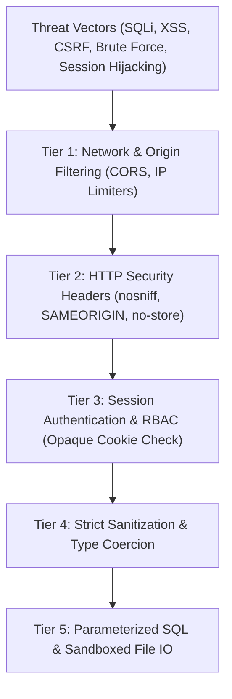

# CHAPTER 11: CYBERSECURITY AND REGULATORY COMPLIANCE

---

## 11.1 Threat Model & Security Architecture

The GW Smart Analytics & ShopPulse platform handles sensitive business transaction records, merchant revenue figures, customer contact lists, and payment claims. To protect these assets against malicious actors, the system implements a **Defense-in-Depth** cybersecurity architecture.



---

## 11.2 Authentication & Password Security
- **Scrypt Key Derivation**: User passwords submitted during registration undergo cryptographic key derivation via Werkzeug's `generate_password_hash` using the **scrypt** algorithm with modern CPU/memory cost factors ($N=32768, r=8, p=1$). Passwords are never stored in plaintext or reversible formats.
- **Opaque Token Web Sessions**: Flask's default client-side cookie session (which serializes data in user-visible base64 cookies) was discarded in favor of an **opaque, database-backed session token**. The browser receives only a 64-character random hexadecimal string, while the server matches its SHA-256 digest against `user_sessions`.
- **Idle & Absolute Session Expiration**:
  - `WEB_SESSION_IDLE_TTL_SECONDS = 43200` (12 Hours of inactivity automatically invalidates the session).
  - `WEB_SESSION_ABSOLUTE_TTL_SECONDS = 2592000` (30 Days maximum lifespan regardless of activity).

---

## 11.3 Defense Against Critical Vulnerabilities

### 11.3.1 SQL Injection (SQLi) Prevention
100% of database interactions within `database.py` employ **parameterized queries** with native positional parameters (`?`). Dynamic string concatenations, f-strings, and `%` formatters are strictly banned in SQL statements:
```python
# SECURE IMPLEMENTATION IN DATABASE.PY:
cursor.execute("SELECT * FROM products WHERE shop_id = ? AND sku = ?", (shop_id, sku))
```

### 11.3.2 Cross-Site Scripting (XSS) Mitigation
- **DOM Escaping**: Dynamic values rendered in client templates utilize `textContent` or `innerText` rather than `innerHTML`.
- **Header Enforcement**: Server responses deliver `X-Content-Type-Options: nosniff` preventing MIME-type confusion execution.

### 11.3.3 Cross-Site Request Forgery (CSRF) Defense
- Session cookies are provisioned with `SameSite=Lax` and `HttpOnly=True`. In production over HTTPS, `Secure=True` is enforced via `GW_COOKIE_SECURE=1`.
- API endpoints restrict cross-origin access strictly to origins whitelisted in `GW_ALLOWED_ORIGINS`.

### 11.3.4 Path Traversal & File Upload Security
- Uploaded files are verified against a strict extension whitelist (`.csv`, `.xlsx`, `.xls`, `.tsv`, `.txt`, `.parquet`).
- Filenames are replaced with cryptographically randomized UUIDs, and paths are validated via `pathlib.Path.resolve()` to ensure files reside strictly inside `UPLOAD_DIR`.

---

## 11.4 Role-Based Access Control (RBAC) & Tenant Data Isolation
- **Tenant Isolation**: In ShopPulse, every database query incorporates `WHERE shop_id = ?`, preventing one shop owner from accessing, viewing, or modifying another store's inventory, sales, or customer data.
- **Administrative Gatekeeping**: High-privilege routes (`/api/admin/payments/*`) verify both active authentication and administrative role assignment (`user["role"].lower() == "admin"`), returning HTTP 403 Forbidden for unauthorized requests.
